# Issue prompts to perform Data Science and Machine Learning tasks

## Introduction

In this lab, you will issue a sequence of prompts to Data Science Agent to perform data science and machine learning tasks. You will run a complete machine learning workflow using natural language, progressing from general questions about the data in the `OMLUSER` schema to model training, model building, evaluation, and scoring.

By the end of this lab, you will see how Data Science Agent helps a novice user explore the dataset in the `OMLUSER` schema, and build and evaluate a machine learning model. Experienced data scientists can also use the agent to complete these tasks more quickly. You will use natural language to prepare data, generate SQL, create visualizations, train models, interpret model results, and score prospects.

>**Note:** This is an agent-driven workflow. Outputs can vary by model, profile, seed, data state, and previous conversation context. Your generated object names and model results may differ. Use the names shown in your response.

Estimated Time: X

### Objectives

In this lab, you will:
* Set the goal and context for a Data Science Agent conversation
* Explore the `CLIENTS`, `CONTACTS`, `PAST_CAMPAIGNS`, and `PROSPECTS` tables
* Frame subscription likelihood as a machine learning problem
* Create a single modeling table from multiple source tables
* Perform feature validation and prepare a clean modeling view
* Split data into training, validation, and test sets
* Train and evaluate a model to predict subscription likelihood
* Score prospects by using the trained model

### Prerequisites

This lab assumes you have:
* Completed all previous labs
* Access to Data Science Agent
* The `CLIENTS`, `CONTACTS`, `PAST_CAMPAIGNS`, and `PROSPECTS` tables added as Associated Objects
* Access to the `OMLUSER` schema

>**Note:**  The output in this lab are examples. The suffixes, selected algorithm, metrics, row counts, and names of models and views may differ when you run the workshop in your environment. Use the object names generated in your session wherever needed.

## Task 1: Define the business problem and discover the available data

In this task, continue the `Predict Subscription` conversation you created in Lab 3: Create a Data Science Conversation. Provide enough context for the agent to understand your role, your experience level, and the data you want to explore. This helps the agent tailor its response and explain the machine learning workflow in an accessible way.

1. Open the `Predict Subscription` conversation, and review the tips displayed in the chat interface.

    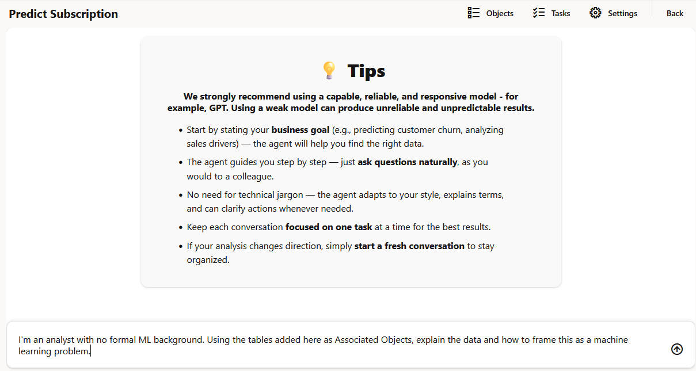

2. Enter the following prompt to set the goal and context for the conversation. This prompt tells Data Science Agent that you are an analyst without any data science background. You ask the agent to explain the data and how to use it to solve a business problem.

    ```text
    <copy>
    I'm an analyst without a data science background, interested on running a new marketing campaign. What data is available and how can it be used?
    </copy>
    ```

    In response to this prompt, Data Science Agent provides an overview of the available data, explains how it can be used in the new marketing campaign, and provides a brief summary of the tables CLIENTS, CONTACTS, PAST_CAMPAIGN, and PROSPECTS. Review the summary of the data in each table and the explanation on how to use this data in the new marketing campaign.

    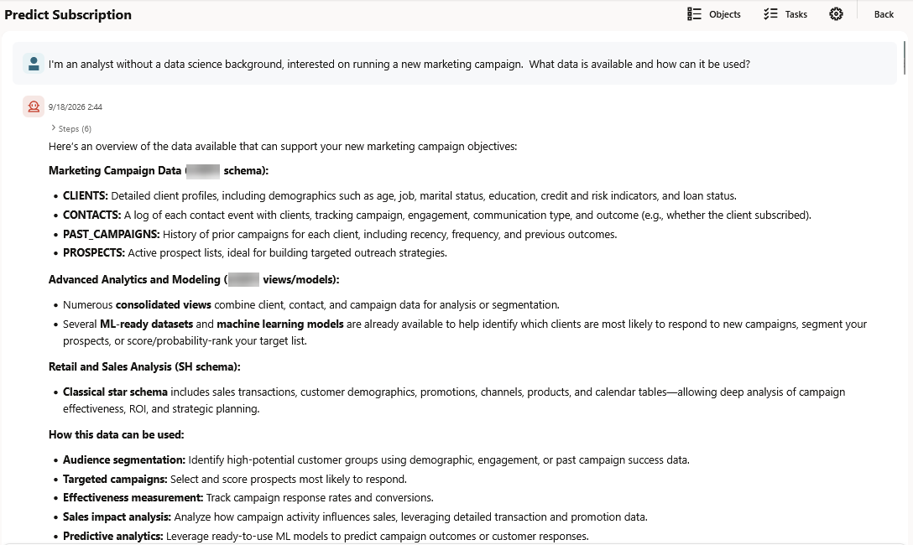

    > **Note:** The outputs in this lab are examples only. The suffixes, selected algorithm, metrics, and row counts may differ in your environment. Use the object names generated in your session wherever needed.

3. Scroll down and expand the **Object Discovery Summary** section. This is the data discovery stage. Here, Data Science Agent provides a list of the keys, main attributes and joins in each table.

    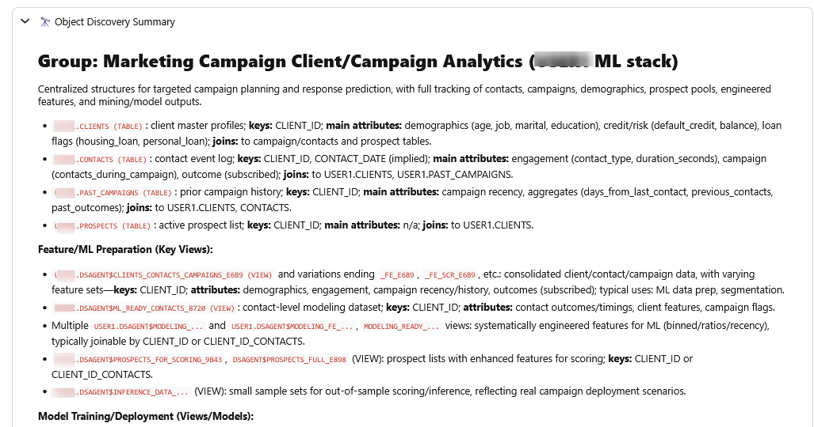

## Task 2: Frame the business problem

In this task, you will explore your customer data and identify who are ones that are most likely to buy your product.

1. Enter the following prompt to explore your customers:

    ```text
    <copy>
    I would like to identify which customers would buy a new insurance product we are launching.
    </copy>
    ```

    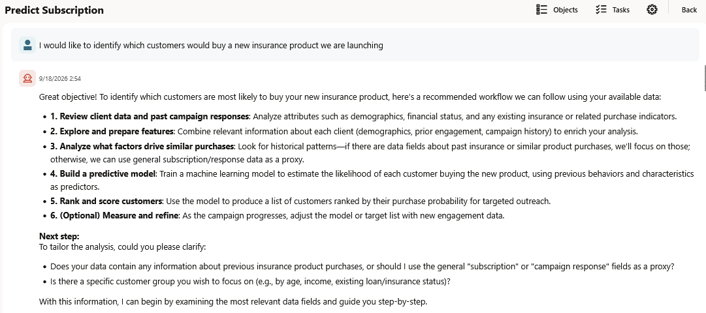

    In response to the prompt, Data Science Agent recommends a workflow based on the available data. It also asks clarifying questions to guide you on the next steps. See screenshot for details.

2. In this step, you will ask Data Science Agent to choose _customers who responded to a campaign as a proxy_ because there was no confirmed insurance-purchase history. Enter the following prompt.

    ```text
    <copy>
    We can focus on customers that have one or more banking products, and want to check customers that responded to a campaign as a proxy.
    </copy>
    ```

    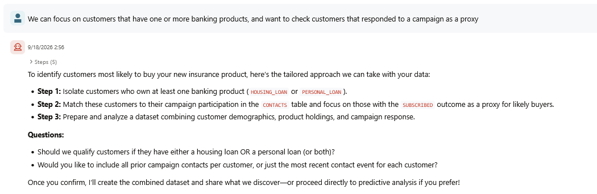

    In response to your input, Data Science Agent suggests a tailored approach based on your data as follows:
    * Find customers who already have at least one banking product, such as a home loan or personal loan.
    * Check whether these customers took part in a campaign and focus on those who responded “SUBSCRIBED,” as they are more likely to buy.
    * Create and study a dataset that combines customer details, banking products, and campaign responses.

    It also asks you to confirm whether to qualify customers (with) or to include all prior campaign.

## Task 3: Create the analysis view

In continuation to the previous task, here you will one step deep and create the view for analysis. For this, you will create and study a dataset that combines products and all available campaign contacts.

1. Review the response and enter the following prompt:

    ```text
    <copy>
    Let's use either product, and use all campaign contacts available
    </copy>
    ```

    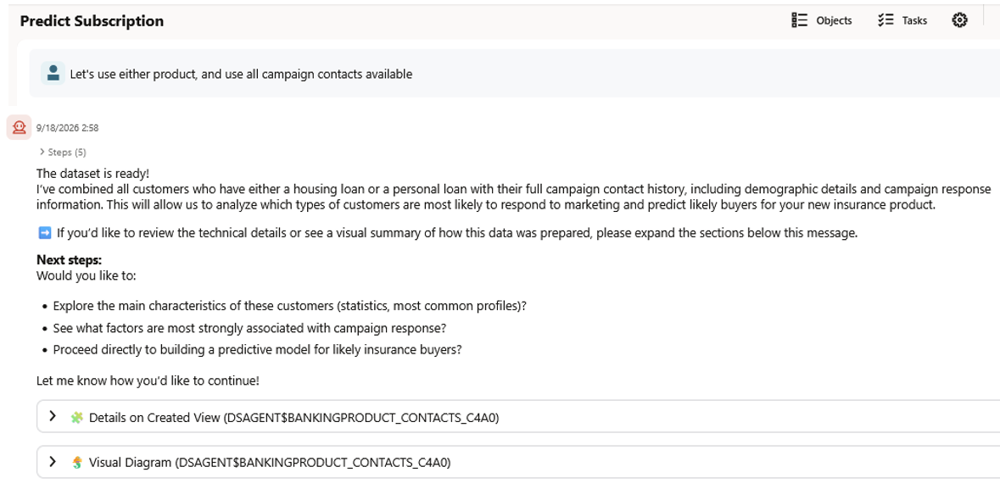

    In response to the prompt, Data Science Agent created the view `DSAGENT$BANKINGPRODUCT_CONTACTS_C4A0` by combining all customers who have either a housing loan or a personal loan with their full campaign contact history. This is done to analyze which types of customers are most likely to respond to marketing, and therefore predict likely buyers.

    >**Note:** The view `DSAGENT$BANKINGPRODUCT_CONTACTS_C4A0` is created for analysis.

2. Expand the **Details on Created View** section to review the SQL code used to define the view `DSAGENT$BANKINGPRODUCT_CONTACTS_C4A0`.

    > **Note:** Views and objects created by Data Science Agent have the prefix `DSAGENT$`.

    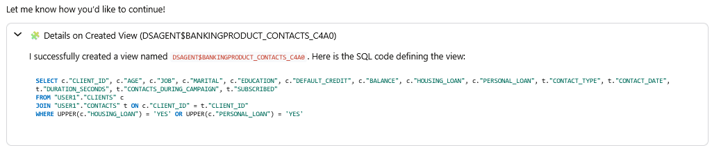

3. Expand the **Visual Diagram** section to understand the workflow of the view `DSAGENT$BANKINGPRODUCT_CONTACTS_C4A0`

    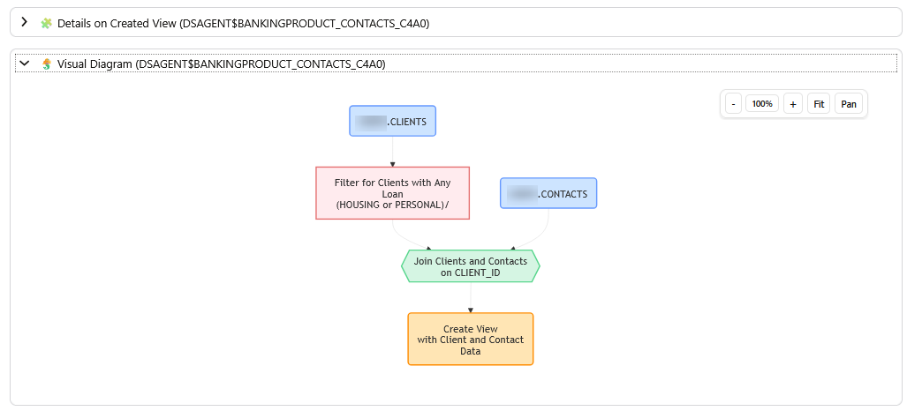

    > **Note:** The outputs in this lab are examples only. The suffixes, selected algorithm, metrics, and row counts may differ in your environment. Use the object names generated in your session wherever needed.

## Task 4: Explore customer characteristics

In this task, you will ask Data Science Agent to explain the characteristics of the customers. You will also ask Data Science Agent to identify the factors that are strongly linked to customers responding to the campaign.

> **Note:** Views and objects created by Data Science Agent have the prefix `DSAGENT$`.

1. Enter the following prompt to explore the dataset and understand the basic statistics.

    ```text
    <copy>
    Let's see the characteristics of these customers
    </copy>
    ```

    In response to this prompt, Data Science Agent provides a summary of the characteristics of the customers (who owned at least one banking product and participated in campaign contacts). The main characteristics of the customers are listed out as - Age Balance, Education, Job, Marital Status, Loan Ownership, Credit Default, Contact Method, Contact Frequency, Contact Duration, and Campaign Response. It also provides a full breakdown of the dataset in summary tables and charts for each variable.

    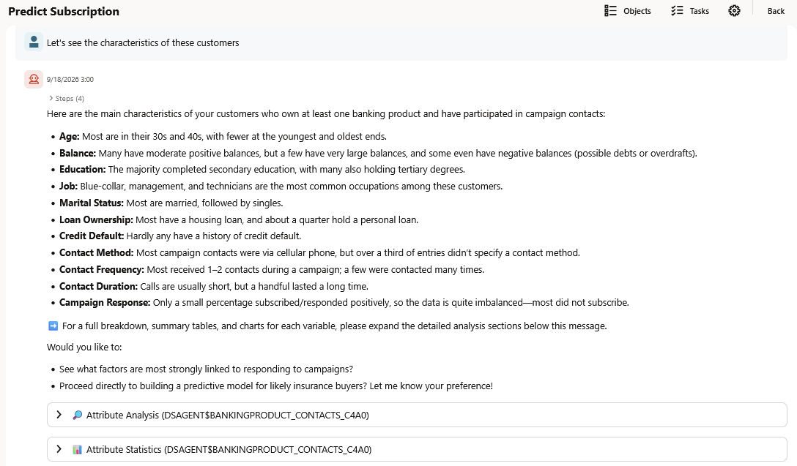

2. Expand the **Attribute Analysis** section for a detailed description and analysis of each attribute.

    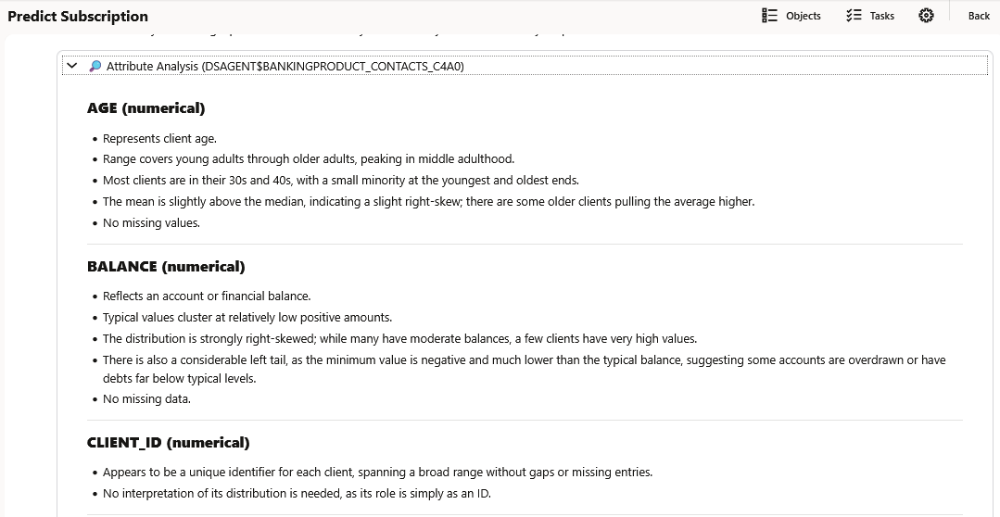

3. Expand the **Attribute Statistics** section for a detailed view of the attributes. For each attribute, it shows the data distribution and statistics, along with a statistical visualization - boxplot, bar chart etc., as applicable. In this example, Data Science Agent depicts the age distribution in a boxplot and it computes these statistics - Mean, Median, Standard Deviation, Minimum value, Maximum value, Quartile 1, Quartile 3, Row counts, and the counts for NON_NULL.

    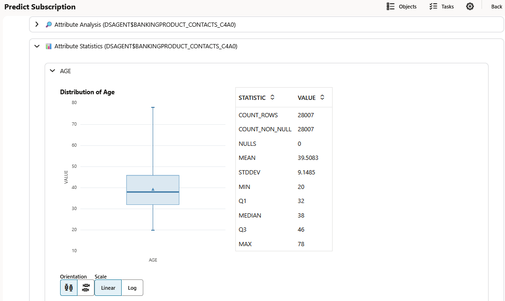

    The agent also asks if you would like to identify the factors that are strongly linked to customers responding to the campaign or to proceed directly to building a predictive model.

    > **Note:** The outputs in this lab are examples only. The suffixes, selected algorithm, metrics, and row counts may differ in your environment. Use the object names generated in your session wherever needed.

## Task 5: Identify useful predictors

In this task, you will identify the factors that are strongly linked to customers responding to the campaign.

1. Enter the following prompt:

    ```text
    <copy>
    Let's check the factors linked to responding to campaigns.  Also, we cannot use the call duration in seconds nor the contact date, since these are not known ahead of the campaign.
    </copy>
    ```

    In response to this prompt, Data Science Agent lists out the factors that are most strongly linked to positive campaign responses among the customers. It also provides a full  statistical details and charts.

    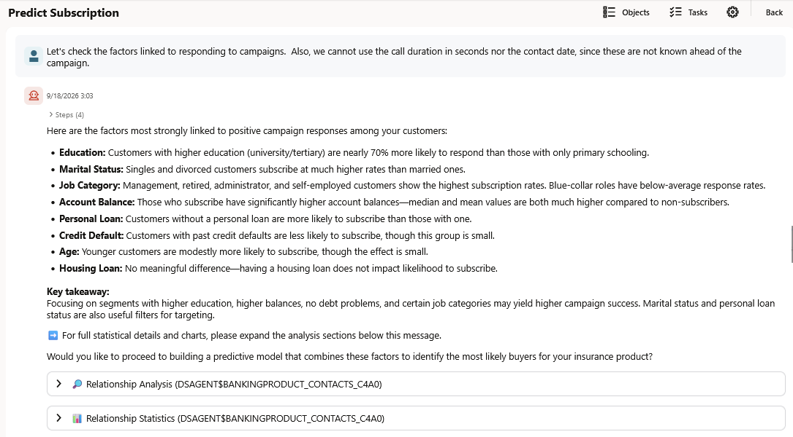

2. Expand the **Relationship Analysis** section for a detailed analysis of the relationship between the various attributes and the likelihood of subscription. See screenshot below:

    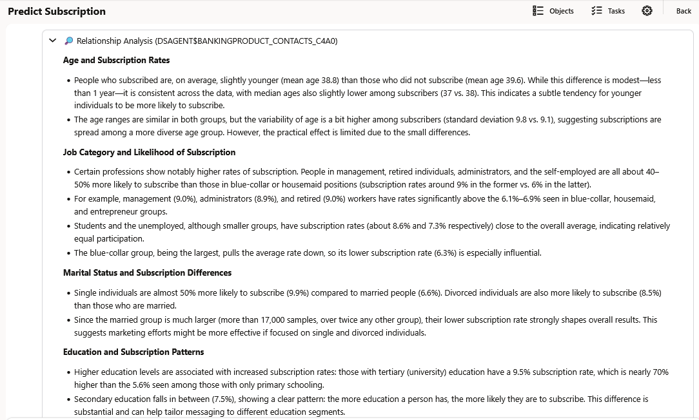

3. Expand the **Relationship Statistics** section for a statistical analysis of the relationship between the various attributes and the likelihood of subscription. See screenshot below:

    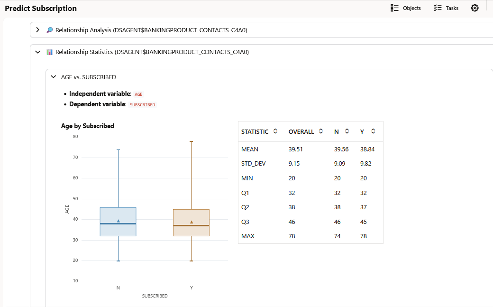

    Data Science Agent also asks you if you would like to proceed to building a predictive model that combines these factors to identify the most likely buyers for your insurance product.

## Task 6: Rank features and build the modeling dataset

Based on the suggestion provided by Data Science Agent, in this task you will proceed to build a predictive model.

1. Enter the following prompt to allow Data Science Agent to build a predictive model:

    ```text
    <copy>
    Yes please, build the model.
    </copy>
    ```

    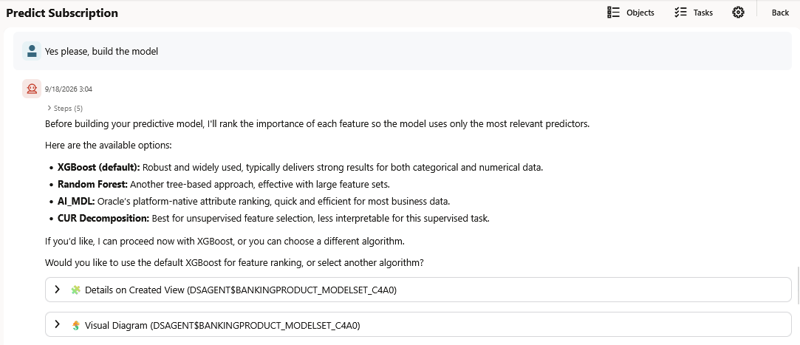

    In response to your prompt, Data Science Agent first ranks the importance of each feature so that the model only uses the most relevant predictors. The agent lists the following algorithms:

    * XGBoost (default)
    * Random Forest
    * AI_MDL
    * CUR Decomposition

    Data Science Agent creates the view `DSAGENT$BANKINGPRODUCT_MODELSET_C4A0`.

    > **Note:** Views and objects created by Data Science Agent have the prefix `DSAGENT$`.

2. Expand the **Details on Created View** section to review the SQL code generated by Data Science Agent to create the view `DSAGENT$BANKINGPRODUCT_MODELSET_C4A0`.

    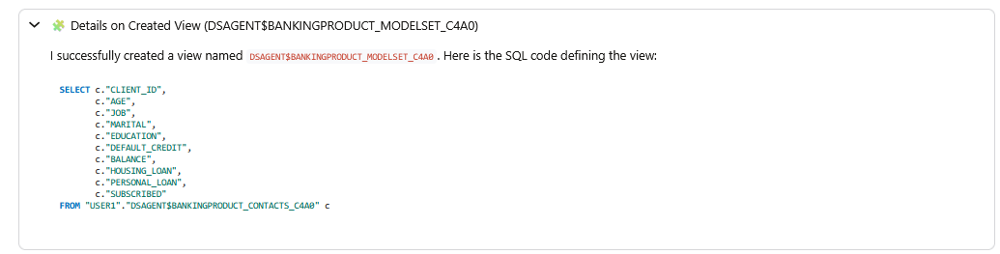

3. Expand the **Visual Diagram** section to understand the workflow of the view `DSAGENT$BANKINGPRODUCT_MODELSET_C4A0`.

    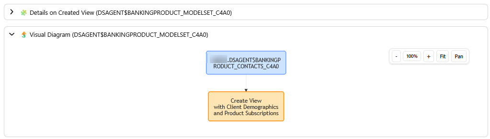

    >**Note:**  The outputs in this lab are examples only. The suffixes, selected algorithm, metrics, and row counts may differ in your environment. Use the object names generated in your session wherever needed.

    Data Science Agent also asks for your choice of algorithm for model building. Or else, the agent would proceed with XGBoost, as it explicitly states.

## Task 7: Split the data and train candidate models

 In this task, you will focus on model building.

1. Enter the following prompt to proceed with model building.

    ```text
    <copy>
    Please proceed.
    </copy>
    ```

    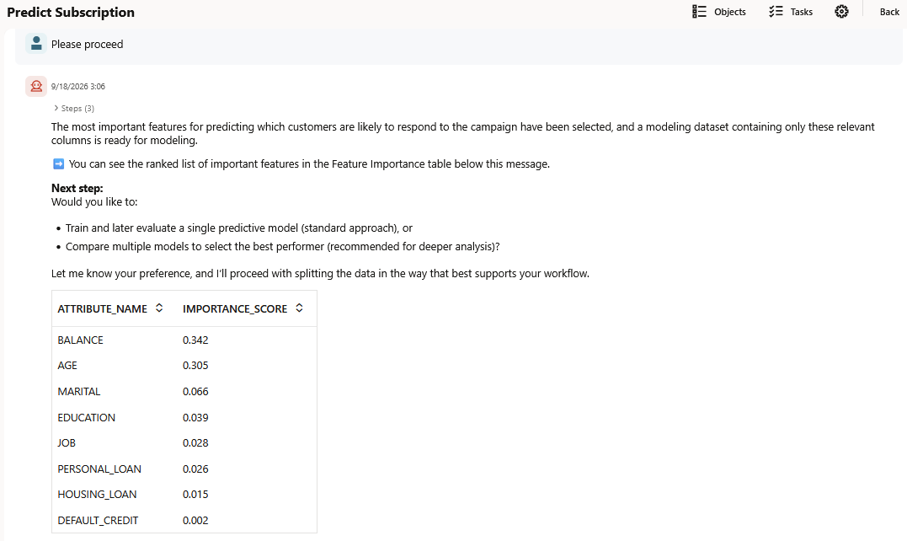

    In response to this prompt, Data Science Agent builds a modeling dataset containing only the most important features for predicting which customers are likely to respond to the campaign.

    The agent provides you with the following choices:
    * Train and later evaluate a single predictive model, or
    * Compare multiple models to select the best performer

2. Now, you will ask Data Science Agent evaluate and compare multiple models. In this process, Data Science Agent splits the data into 70% training dataset, 20% test dataset, and 10% validation dataset.Enter the following prompt to evaluate the model.

    ```text
    <copy>
    Compare multiple models please.
    </copy>
    ```

    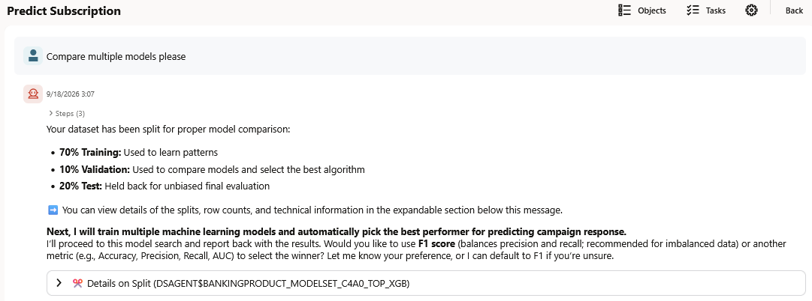

    In response to this prompt, Data Science Agent evaluates the model and splits the data into:

    * 70% Training: Used to learn patterns
    * 10% Validation: Used to compare models and select the best algorithm
    * 20% Test: Held back for unbiased final evaluation

2. Expand the **Details on Split** section to review the splits created from the view `DSAGENT$BANKINGPRODUCT_MODELSET_C4A0_TOP_XGB`. See screenshot below:

    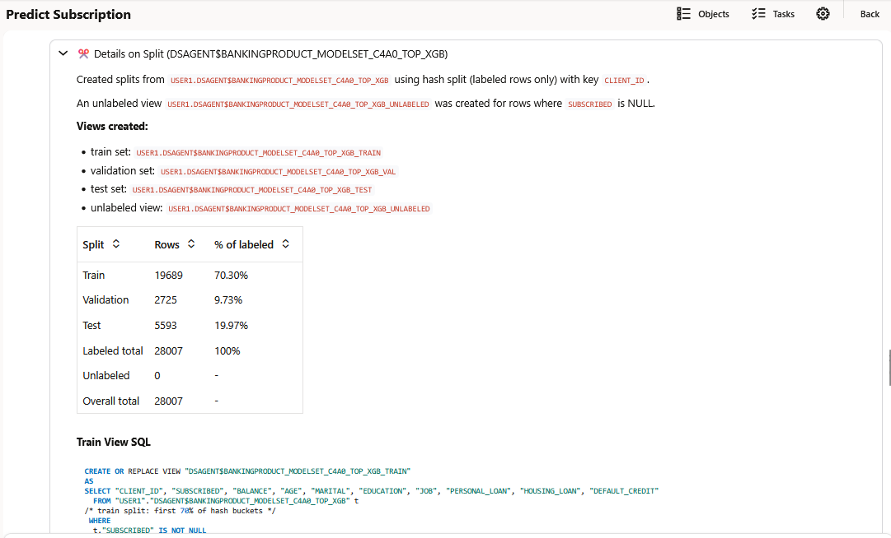

    Here, Data Science Agent provides the details on the views created.

## Task 8: Select the best model and evaluate it on test data

In this task, you will suggest Data Science Agent to pick up a model and score the prospects for the next campaign.

>**Note:**  The outputs in this lab are examples only. The view names, model names, suffixes, selected algorithm, metrics, and row counts may differ in your environment. Use the object names generated in your session wherever needed.

1. Enter the following prompt to score the xxx

    ```text
    <copy>
    Default to F1 please
    </copy>
    ```

    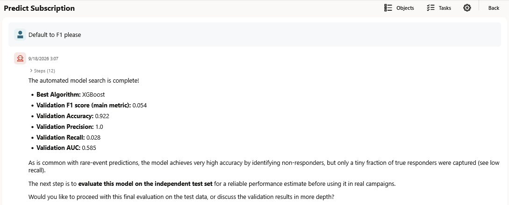

    Here, Data Science Agent conducts an automated model search and presents the model with best algorithm which is XGBoost. It also suggests the next step which is to evaluate the model on the independent test dataset prior to using it on real campaigns.
    Data Science Agent trains models using several algorithms, compares them on the validation set using F1, and selects XGBoost as the best performer. It saves the trained model as `DSAGENT$INSURANCE_CAMPAIGN_CLASSIFIER_C4A0`.

2. Prompt "Yes please proceed" in your response to the agent's suggestion to evaluate the model.

    ```text
    <copy>
    Yes please proceed
    </copy>
    ```
    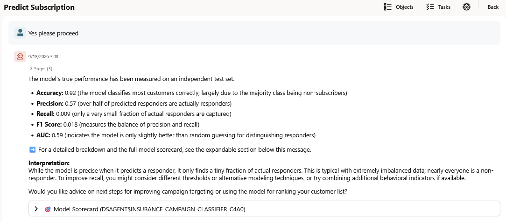

    Now, Data Science Agent measures the performance of the model on an independent test set. It computes the accuracy of the model to be 92%. It also presents the model scorecard and the following interpretation of the model:

    `While the model is precise when it predicts a responder, it only finds a tiny fraction of actual responders. This is typical with extremely imbalanced data; nearly everyone is a non-responder. To improve recall, you might consider different thresholds or alternative modeling techniques, or try combining additional behavioral indicators if available.`

3. Expand the **Model Scorecard** section to review the performance score of the model `DSAGENT$INSURANCE_CAMPAIGN_CLASSIFIER_C4A0`.

    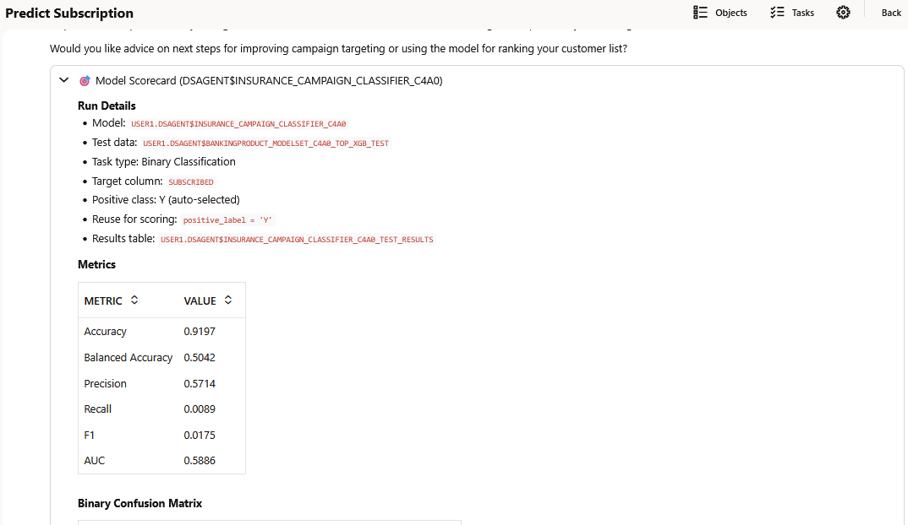

4. Scroll down to view the confusion matrix.

    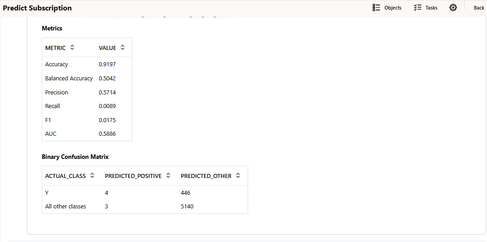

## Task 9: Score and rank customers for campaign outreach

In this task, you will focus on scoring with the model and ranking your customers.

1. Enter the following prompt to view your customer ranking:

    ```text
    <copy>
    Show me a rank of my top customers most likely to respond
    </copy>
    ```

    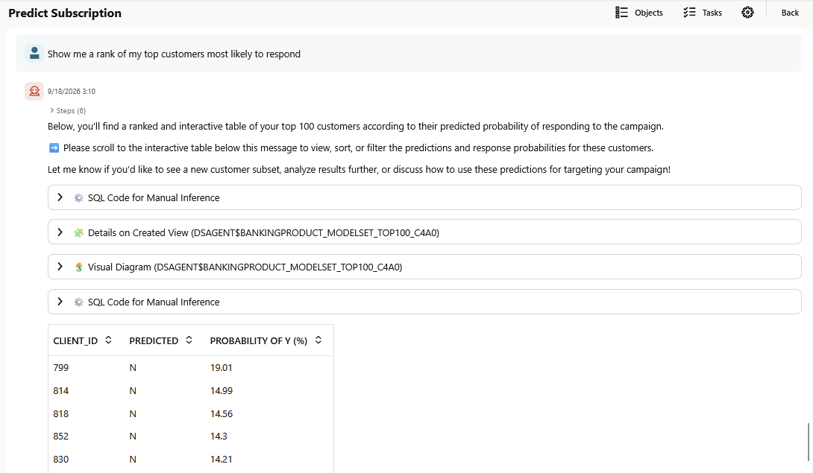

2. Expand the **SQL Code for Manual Inference** section to refer to the SQL code to run the inference manually:

    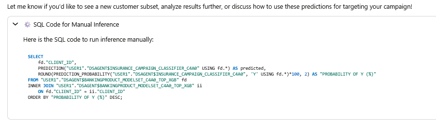

3. Expand the **Details on Created View** section to review the view `DSAGENT$BANKINGPRODUCT_MODELSET_TOP100_C4A0`

    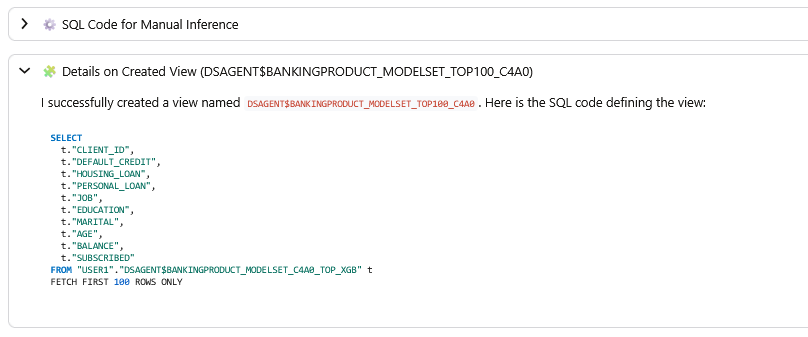

4. Expand the **Visual Diagram** section to review the workflow of the view `DSAGENT$BANKINGPRODUCT_MODELSET_TOP100_C4A0`.

    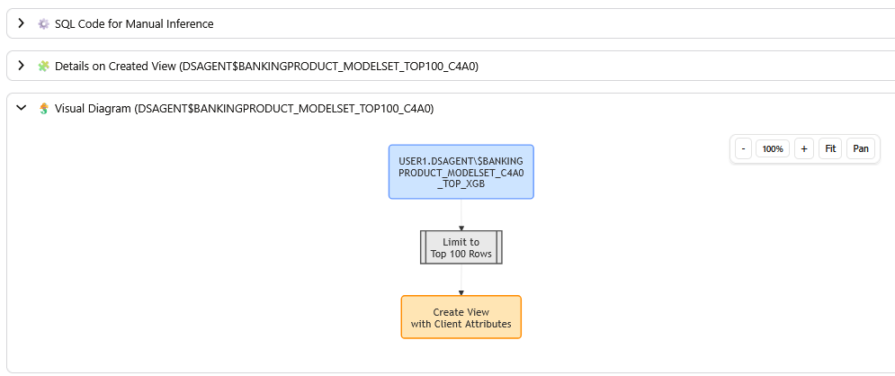

5. Scroll down to view a copy of the interactive table created by Data Science Agent.

    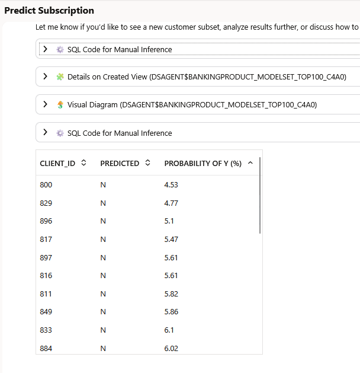

    | CLIENT_ID | PREDICTED | PROBABILITY OF Y (%) |
|---:|:---:|---:|
| 799 | N | 19.01 |
| 814 | N | 14.99 |
| 818 | N | 14.56 |
| 852 | N | 14.3 |
| 830 | N | 14.21 |
| 885 | N | 12.35 |
| 798 | N | 11.57 |
| 876 | N | 11.54 |
| 891 | N | 11.48 |
| 864 | N | 11.43 |
| 831 | N | 11.15 |
| 835 | N | 10.89 |
| 872 | N | 10.72 |
| 820 | N | 10.71 |
| 856 | N | 10.71 |
| 868 | N | 10.59 |
| 871 | N | 10.5 |
| 860 | N | 10.5 |
| 887 | N | 10.32 |
| 890 | N | 10.17 |
| 855 | N | 9.92 |
| 840 | N | 9.89 |
| 869 | N | 9.82 |
| 867 | N | 9.82 |
| 863 | N | 9.63 |
| 862 | N | 9.55 |
| 901 | N | 9.45 |
| 842 | N | 9.24 |
| 892 | N | 9.02 |
| 878 | N | 8.94 |
| 850 | N | 8.92 |
| 821 | N | 8.85 |
| 898 | N | 8.72 |
| 902 | N | 8.57 |
| 879 | N | 8.29 |
| 804 | N | 8.28 |
| 827 | N | 8.28 |
| 822 | N | 8.05 |
| 828 | N | 8.05 |
| 808 | N | 8.05 |
| 825 | N | 8.05 |
| 889 | N | 8.03 |
| 826 | N | 8.01 |
| 851 | N | 7.94 |
| 877 | N | 7.94 |
| 824 | N | 7.8 |
| 874 | N | 7.8 |
| 812 | N | 7.78 |
| 866 | N | 7.68 |
| 883 | N | 7.68 |
| 797 | N | 7.68 |
| 802 | N | 7.66 |
| 873 | N | 7.62 |
| 903 | N | 7.62 |
| 823 | N | 7.59 |
| 882 | N | 7.58 |
| 854 | N | 7.58 |
| 847 | N | 7.5 |
| 893 | N | 7.49 |
| 837 | N | 7.34 |
| 845 | N | 7.33 |
| 899 | N | 7.33 |
| 839 | N | 7.33 |
| 803 | N | 7.24 |
| 858 | N | 7.24 |
| 881 | N | 7.24 |
| 844 | N | 7.24 |
| 834 | N | 7.22 |
| 807 | N | 7.21 |
| 832 | N | 7.18 |
| 809 | N | 7.18 |
| 888 | N | 7.15 |
| 859 | N | 7.15 |
| 836 | N | 7.11 |
| 813 | N | 7.03 |
| 857 | N | 7.03 |
| 880 | N | 6.87 |
| 846 | N | 6.85 |
| 843 | N | 6.8 |
| 894 | N | 6.5 |
| 900 | N | 6.5 |
| 886 | N | 6.48 |
| 848 | N | 6.33 |
| 853 | N | 6.33 |
| 865 | N | 6.31 |
| 895 | N | 6.23 |
| 838 | N | 6.22 |
| 841 | N | 6.22 |
| 796 | N | 6.22 |
| 806 | N | 6.17 |
| 833 | N | 6.1 |
| 884 | N | 6.02 |
| 849 | N | 5.86 |
| 811 | N | 5.82 |
| 897 | N | 5.61 |
| 816 | N | 5.61 |
| 817 | N | 5.47 |
| 896 | N | 5.1 |
| 829 | N | 4.77 |
| 800 | N | 4.53 |

    In this example, Data Science Agent returns the probability of subscription for the prospects in an interactive table. A copy of the table (in static format) is presented here.


>**Note:**  The outputs in this lab are examples only. The view names, model names, suffixes, selected algorithm, metrics, and row counts may differ in your environment. Use the object names generated in your session wherever needed.

## Learn More

* [Oracle Machine Learning](https://docs.oracle.com/en/database/oracle/machine-learning/)
* [Oracle Data Science Agent](https://docs.oracle.com/en/database/oracle/machine-learning/data-science-agent/index.html)
* [Oracle Autonomous Database](https://docs.oracle.com/en/cloud/paas/autonomous-database/)
* [Oracle LiveLabs](https://livelabs.oracle.com/ords/r/dbpm/livelabs/home)

## Acknowledgements

* **Author** - Moitreyee Hazarika, Consulting User Assistance Developer, Oracle AI Database User Assistance Development
* **Contributors** - Mark Hornick, Senior Director, Data Science and Machine Learning; Marcos Arancibia Coddou, Product Manager, Oracle Data Science; Sherry LaMonica, Consulting Member of Tech Staff, Machine Learning
* **Last Updated By/Date** - Moitreyee Hazarika, October 2026
