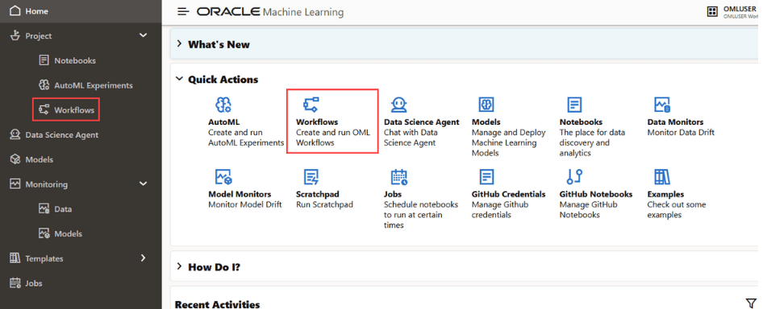

# Introduction to Oracle Machine Learning Workflows

## Introduction

This lab walks you through accessing Oracle Machine Learning (OML) Workflows and creating a workflow in the OML user interface.

Estimated Time: 15 minutes

### About

OML Workflows provides a visual canvas for arranging machine learning tasks as nodes and connectors. In this lab, you will open the Workflows page, create a workflow, and inspect the workflow editor.

### Objectives

In this lab, you will learn how to:

* Access OML Workflows.
* Create a workflow.
* Locate the workflow nodes palette, canvas, and settings pane.

### Prerequisites

This lab assumes you have:

* An Oracle Machine Learning user account and the URL for your OML user interface.
* Permission to sign in to OML and access Workflows.
* A supported OML environment available to you.

A data source is not required to create the workflow in this lab. To configure or run a Data Source node, you will also need access to a database schema and table.

## Task 1: Access OML Workflow

To access Workflows:

1. Open the Oracle Machine Learning user interface URL provided by your administrator, and sign in with your OML credentials.

   

2. On the OML home page, select **Workflows** from Quick Actions.

   Alternatively, open the left navigation menu, expand **Project**, and select **Workflows**.

   

3. Confirm that the Workflows page opens. The page lists workflows available to you and provides actions such as **Create**, **Edit**, **Duplicate**, and **Delete**, subject to your access and the workflow status.

   

## Task 2: Create a Workflow

To create a workflow:

1. On the Workflows page, select **Create**.

   

2. In the Create Workflow dialog:
   * Enter a name for the workflow. For this lab, use **OML_Workflow_Lab**.
   * Optionally enter a comment, such as **Introductory OML Workflow lab**.
   * Select **OK**.

3. Confirm that the blank workflow opens in the workflow editor.

   

4. Identify the main areas of the editor:
   * **Workflow Nodes palette** on the left: contains nodes that you can add to the workflow.
   * **Canvas** in the center: where you arrange nodes and their connections.
   * **Settings pane** on the right: displays settings for the selected node. It is collapsed by default; select the expand control to open it.

5. Add a starting node to the canvas:
   * From the Workflow Nodes palette, drag a **Data Source** node onto the canvas. You can also use the node's Add control.
   * Select the node and notice that its settings are available in the Settings pane.

   

   You do not need to configure or run the node for this lab. To run a complete workflow, configure each node and its connections first; you can then run an individual node or select **Run All**.

**Expected result:** The Workflows page contains the new **OML_Workflow_Lab** workflow, and the workflow editor displays a Data Source node on its canvas.

## Learn More

* [Oracle Machine Learning Workflows](https://docs.oracle.com/en/database/oracle/machine-learning/oml-notebooks/omlug/Chunk905584424.html#GUID-2F81E1E6-60D1-4971-A226-8AE2197F5F5C)

## Acknowledgements

* **Author**: Moitreyee Hazarika, Consulting User Assistance Developer, Database User Assistance Development
* **Contributors**: Mark Hornick, Senior Director, Data Science and Machine Learning; Marcos Arancibia Coddou, Product Manager, Oracle Data Science; Sherry LaMonica, Consulting Member of Tech Staff, Machine Learning
* **Last Updated By/Date**: Moitreyee Hazarika, October 2026
