# Introduction to Oracle Machine Learning Workflows

## Introduction

This lab walks you through accessing Oracle Machine Learning (OML) Workflows and creating a workflow in the OML user interface.

Estimated Time: 15 minutes

### About

OML Workflows provides a visual canvas for arranging machine learning tasks as nodes and connectors. In this lab, you will open the Workflows page, create a workflow, and inspect the workflow editor.

### Objectives

In this lab, you will learn how to:

* Access OML Workflows.
* Create a workflow.
* Locate the workflow nodes palette, canvas, and settings pane.

### Prerequisites

This lab assumes you have:

* An Oracle Machine Learning user account and the URL for your OML user interface.
* Permission to sign in to OML and access Workflows.
* A supported OML environment available to you.

A data source is not required to create the workflow in this lab. To configure or run a Data Source node, you will also need access to a database schema and table.

## Task 1: Access OML Workflow

To access Workflows:

1. Open the Oracle Machine Learning user interface URL provided by your administrator, and sign in with your OML credentials.

   

2. On the OML home page, select **Workflows** from Quick Actions.

   Alternatively, open the left navigation menu, expand **Project**, and select **Workflows**.

   

3. Confirm that the Workflows page opens. The page lists workflows available to you and provides actions such as **Create**, **Edit**, **Duplicate**, and **Delete**, subject to your access and the workflow status.

   

## Task 2: Create a Workflow

Here, you will use all the workflow nodes to create a workflow to predict xxx

To create a workflow:

1. On the Workflows page, select **Create**.

   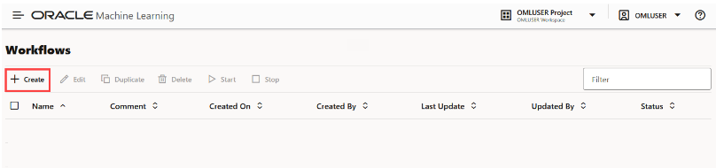

2. In the Create Workflow dialog:

   [Create Workflow](images/create-workflow-dialog.png)
   * Enter a name for the workflow. For this lab, use **Predict**.
   * Optionally, you may enter a comment.
   * Click **OK**.

3. Confirm that the blank workflow opens in the workflow editor.

   

4. Identify the main areas of the editor:
   * **Workflow Nodes palette** on the left: contains nodes that you can add to the workflow.
   * **Canvas** in the center: where you arrange nodes and their connections.
   * **Settings pane** on the right: displays settings for the selected node. It is collapsed by default; select the expand control to open it.

5. Add a starting node to the canvas:
   * From the Workflow Nodes palette, drag and drop a **Data Source** node onto the canvas. You can also use the node's Add control.
   * Select the node and notice that its settings are available in the Settings pane on the right.

   

   You do not need to configure or run the node for this lab. To run a complete workflow, configure each node and its connections first; you can then run an individual node or select **Run All**.

## Task 3: Add a Data Source node

The Data source node defines the workflow’s data source by specifying the schema and table. It supports data-related tasks such as data import, data splitting, and basic statistical computations. This node typically serves as the starting point of a workflow.

To create and run a Data Source node:
1. On the Workflows editor, drag and drop the Data Source node from the palette to the canvas. You may also click the + icon next to the Data Source node to add it to the canvas.

2. Adding a node automatically opens the settings pane on the right. Define the following settings:

      * **Name:** Enter a name. In this example, it is Data source 1.
      * **Source Schema:** Click on the drop-down menu to select the schema. Here, SH schema is selected.
      * **Source table:** Click on the drop-down menu to select the table. Here, `SUPPLEMENTARY_DEMOGRAPHICS` table is selected. Once you select the table, the Features field below displays the columns of the table. 
      * **Target ID column name:** From the drop-down menu, select a target. This is the target for your prediction. Select `AFFINITY_CARD`.
      * **Features:** This field displays all the columns of the selected table, and has all of them selected. You may deselect any column.
      * **Split Data:** By default, this option is selected and 20% is allotted for test data. You can edit this field.
      * Compute Descriptive Stats: Select this option to allot a dataset percentage for descriptive statistics computation. The default is `100%`.
      * **Compute Data Correlation:** Select this option if you want to compute correlation between two variables in the dataset. Correlation is a bivariate analysis that measures the strength of association between two variables and the direction of the relationship. IN this lab, select `pearson`.

         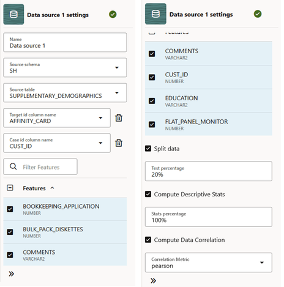

3. After defining the node, click on the ellipses on the node or right-click to open the menu. Click **Run**. Once the node runs successfully, it is indicated by the green tick icon.

   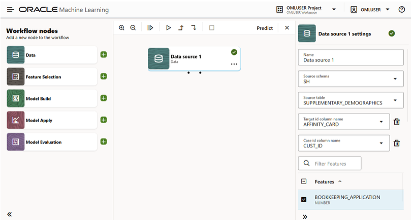

4. Click on the ellipses on the node or right click on the node and click **Results** to to view the results.

   * The Data Statistics tab displays the basic statistics computed for the selected features (columns). The computed statistics are Distinct Count, Number of Unique values, Top N, Frequent values, Mean, Std deviation, Min, 25, 50, 75 quantiles, and Max.

   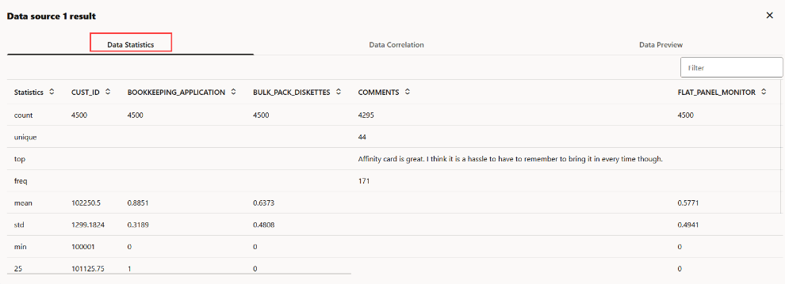

   * The Data Correlation tab displays the correlation level between the columns. Positive values indicate positive correlation, and the different shades of red indicate the different levels of positive correlation. Negative values indicate negative correlation, and the different shades of blue indicate the levels of negative correlation. A value of 1 indicates perfect positive correlation and a value of -1 indicates perfect negative correlation.

   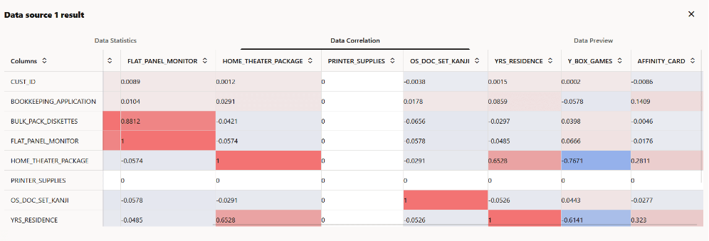

   * The Data Preview tab shows the preview of the data set used for the workflow.

   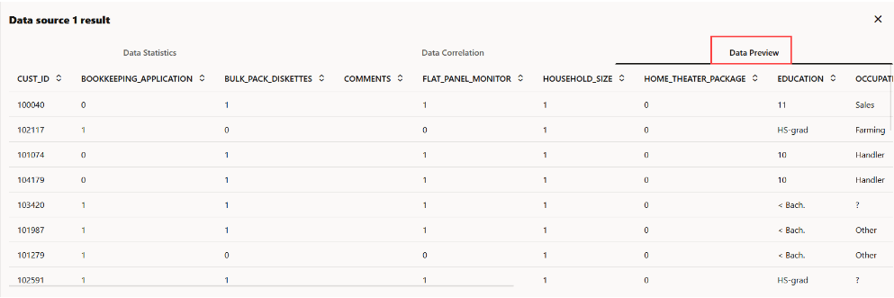

## Task 4: Add a Feature Selection node

The Feature Selection node selects a subset of relevant features (columns) to help improve model performance. It uses attribute-importance results generated during model training to guide feature selection.

To add and run a Feature Selection node:

1. From the workflow palette, drag and drop the Feature Selection node to the canvas. You may also click the + icon next to the Feature Selection node to add it to the canvas.

   > **Note:** You may also click **Recommend next node** on the Data Source node (upstream node) and then click **Feature Selection**. Using this option automatically connects the nodes.

2. Since we are adding the node manually in this lab, we must establish a connection from the Data Source node (upstream node) to the Feature Selection node (downstream node). For this, click on the connection port indicated by the dot on the Upstream node. A connector appears. Drag the connector to the downstream node to establish the connection.

   > **Note:** The Data Source node has two connection ports. The one on the left is for Train dataset, and the one on the right is for Test dataset.

   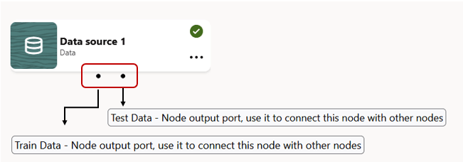

3. After connecting the nodes, click on the **Feature Selection** node to open the settings. Select these details: 

   * **Name:** Enter Feature Selection 1
   * **Target id column name:** Select `AFFINITY_CARD`.
   * **Mining Function:** The Mining function selected is **Classification**. 
      >**Note**: The selection of mining function is automatic. It depends on the target you selected. However, you can override it.
   * **Case id column name:** Select `CUST_ID`.

> **Note:** If the **Settings** pane is not visible, click the << icon open at the bottom to expand the pane.

4. Right click on the node or click on the ellipses and then click Run. Once the node runs successfully, it is indicated by the green tick mark. 

   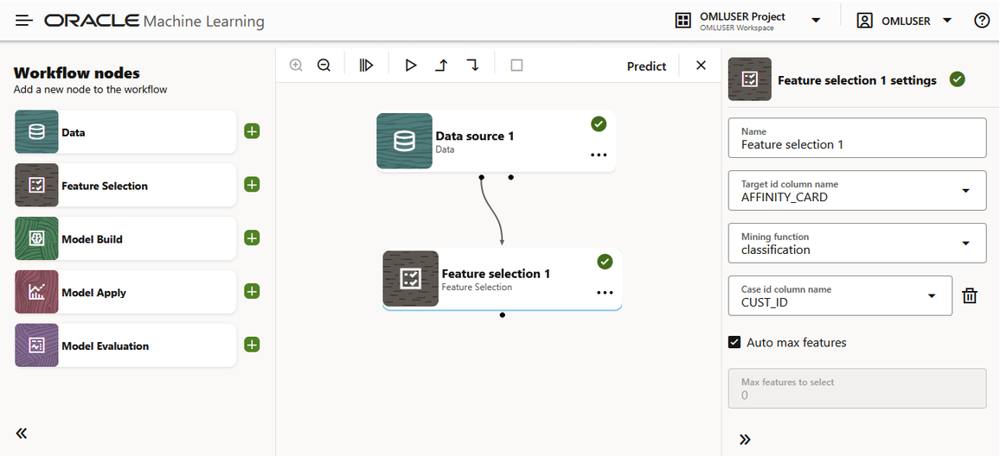

2. Once the node is run successfully, right-click on the node and then click **Results** to view the results.

## Task 5: Add a Model Build node

The Model Build node builds and trains machine learning or statistical models using supported algorithms.
To add and run a Model Build node:

1. On the Workflow editor, drag and drop a Model Build node from the palette to the canvas.

2. From the Upstream node (Feature Selection node), establish a connection to the Model Build node. For this, click on the connection port indicated by the dot on the Upstream node. A connector appears. Drag the connector to the downstream node to establish the connection.

   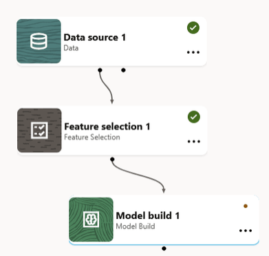

3. After connecting the nodes, define the settings. Click on the Model Build node to open the settings pane on the right. Define the following settings:

      * **Name:** Enter `Model Build 1`
      * **Target id column name:** The value is set to `AFFINITY_CARD`.
      * **Mining Function:** The value is set to `Classification`.
      * **Case id column name:** The value is set to `CUST_ID`.
      * **Algorithms:** The selected algorithms are Decision Tree, Naive Bayes, Neural Network, and Random Forest.
      * **Sampling:** Retain the default which is `100%`.
      * **Partitioning columns:**Select `YRS_RESIDENCE`.
      * **Mining function:** The selection of the mining function is automatic. It depends on the target you selected. However, you can override it.

      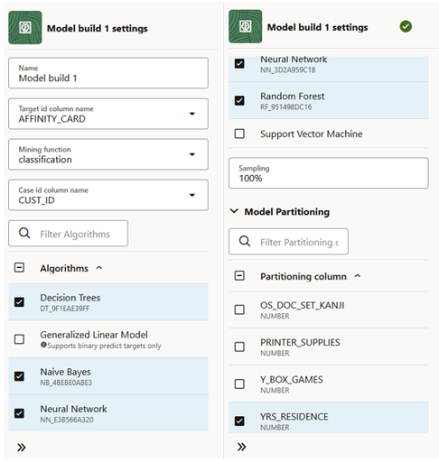

4. Right click on the node or click on the ellipses, and then click **Run**. Once the node runs successfully, it is indicated by the green tick mark.

5. Once the node is run successfully, right-click on the node and then click **Results** to view the results. The results computed by the selected algorithms are displayed in respective tabs. 

   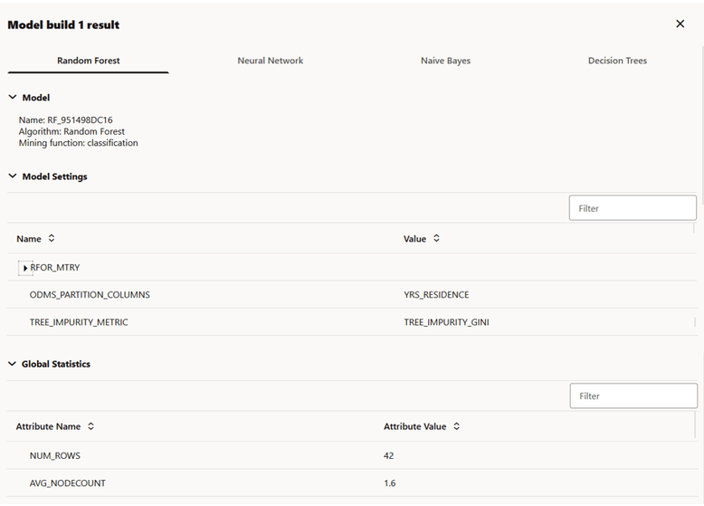

   The results for each algorithm are displayed in separate tabs. In this example, the results are displayed in separate tabs by the name - **Random Forest**, **Neural Network**, **Naive Bayes**, and **Decision Tree**. These are the algorithm selected in the settings for this node. Each tab displays the **Model Details** (model name, algorithm, mining function), **Model Settings** for the specific algorithm, and **Global Statistics** containing the attributes and attribute values.

## Task 6: Add a Model Evaluation node

## Task 7: Add a Model Apply node

## Task 8: Deploy a model

**Expected result:** The Workflows page contains the new **Predict** workflow, and the workflow editor displays a Data Source node on its canvas.

## Learn More

* [Oracle Machine Learning Workflows](https://docs.oracle.com/en/database/oracle/machine-learning/oml-notebooks/omlug/Chunk905584424.html#GUID-2F81E1E6-60D1-4971-A226-8AE2197F5F5C)

## Acknowledgements

* **Author**: Moitreyee Hazarika, Consulting User Assistance Developer, Database User Assistance Development
* **Contributors**: Mark Hornick, Senior Director, Data Science and Machine Learning; Marcos Arancibia Coddou, Product Manager, Oracle Data Science; Sherry LaMonica, Consulting Member of Tech Staff, Machine Learning
* **Last Updated By/Date**: Moitreyee Hazarika, October 2026
